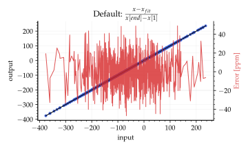
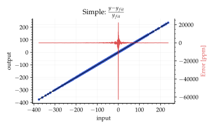
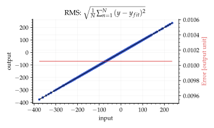
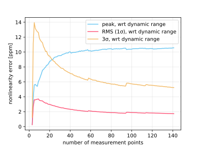

# Linearity.jl

Julia package to measure the nonlinearity of a sensor (e.g. a gyroscope) from calibration data. It fits a least-squares line to output vs. input and reports how far the data deviates from it.

## Usage

```julia
using Linearity

# x: applied inputs (e.g. °/s), y: measured outputs (mean of each stable measurement)
lin = nonlinearity(x, y)             # per-point error relative to the dynamic range
lin = nonlinearity(x, y, Simple)     # per-point error relative to the best-fit line
lin = nonlinearity(x, y, RMS)        # RMS of the residuals, in units of y
lin = nonlinearity(x, y, Sigma3)     # 3σ relative to the dynamic range (datasheet-style)

lin.nonlinearity * 1e6               # convert to ppm
```

Every method returns `(nonlinearity, ang_coef, offset, x_fit, y_fit)`.

## Examples

Default (relative to the dynamic range), `Simple` (relative to the best fit) and `RMS`:





Note how the number of points used in the linear fit influences the nonlinearity error.
With few points, the peak error (default method, wrt. full scale) tends to be smaller,
underestimating the nonlinearity, because the line adapts to the points used. The value
generally increases with the number of points and stabilizes as all measured points are
used, so report the full-dataset value.



## Comparing with datasheets

Check how the datasheet defines "nonlinearity" before comparing numbers:

- **Peak deviation from the best-fit line**, as % of full scale, is the most common definition
  (e.g. Bosch, TI). Use the default method.
- **A σ value (1σ or 3σ)** may be the spread of the fit residuals, which `RMS` and `Sigma3`
  compute, or the spread across units. Datasheets rarely say which.
- **`Simple`** diverges near zero output, so it is not suitable for sensors that cross zero.